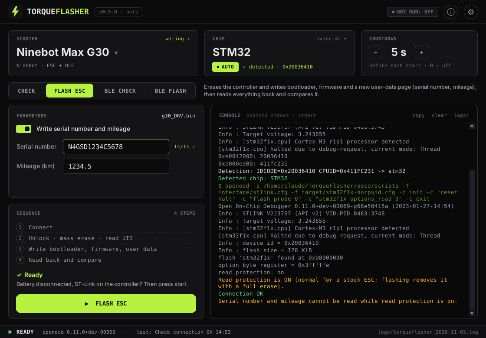

# TorqueFlasher

Flash the **ESC (DRV)** and **BLE module** of Ninebot and Xiaomi scooters over an **ST-Link**, on
**Windows and Linux**, without .NET. Includes backup, restore and serial-number (region) change for the
**Ninebot E3 / E3 Pro**.

TorqueFlasher uses the same OpenOCD command sequences as ScooterHacking's ReFlasher and its bootloader /
firmware files, and adds a read-back check after every write.



> **Beta. Use at your own risk.** Flashing erases the controller and can brick it. Not affiliated with
> Segway-Ninebot, Xiaomi or ScooterHacking.

## Scooters

| Brand | Models | Chip |
|---|---|---|
| Ninebot | ES1/ES2/ES4 (ESx), E22/E25/E45 (E) | STM32 |
| Ninebot | F20, F30, F40, D18, D28, D38, Max G30, Max G2 | STM32 / AT32, detected automatically |
| Ninebot | F2 / Plus / Pro | STM32 / AT32, detected; or GD32 with special files (own entry) |
| Ninebot | E2 Pro (firmware `32kmh.bin` by BastelPichi included, other firmware selectable) | STM32 / AT32, detected |
| Ninebot | E3 / E3 Pro: backup, restore, serial-number change (no flashing) | AT32 |
| Xiaomi | M365, Mi Pro | STM32 |
| Xiaomi | Mi Lite / Essential, 1S, Pro 2, Mi 3 | STM32 or GD32, chosen by you |

BLE flashing is available where ReFlasher has a BLE file (not for G2, F2, D18/D28/D38, E2 Pro).

**Chip:** for models that come with STM32 or AT32, *Check connection* detects the chip and TorqueFlasher keeps
using it (shown as `AUTO ✓ detected`). Flash ESC detects it again and stops if the controller changed since the
check. If detection fails, set the chip by hand with *override*. Xiaomi models that also exist with a GD32 chip
show an STM32 / GD32 switch instead; the check warns when the chip looks different from your choice.

## Actions

| Action | What it does |
|---|---|
| **Check connection** | Detects the chip, probes ST-Link and controller (device id, flash size, read protection). On an unlocked chip it also reads **serial number, mileage and UID** and saves them to `dumps/`. Writes nothing. |
| **Flash ESC** | Removes read protection, mass erase, reads the chip UID, writes bootloader @ `0x0`, firmware @ `0x1000` and a new user-data page (serial number, mileage, UID), then **reads everything back and compares it**. Values read by the last check can be taken over with one click. |
| **BLE check / BLE flash** | nRF51822: probe; or mass erase, bootloader, firmware, Bluetooth name, UICR, each with OpenOCD verify. |
| **E3 / E3 Pro** | Check, read serial number, full 128 KB backup with SHA-256, change serial number (backup first, then 2 KB written and verified), restore backup, make a patched dump offline. |

The **countdown** before each start is set with − / + in the header (0 = off). Actions that write ask for one
confirmation. **Dry run** (top bar or Settings) shows all OpenOCD commands in the console without touching the chip.

**Settings:** accent color, dry run, program folder check, E3 backup folder, dumps and logs.
**Info:** version, hardware test status, *Report a test result*, credits and licenses.

## Power and wiring

The controller is **powered by the ST-Link only. Disconnect the scooter battery first.**

| Scooter | Supply from the ST-Link |
|---|---|
| G2, F2, E2 Pro, Max G30 | 5 V + GND at the controller's cable plug; SWDIO + SWCLK at the back (community info) |
| E3 / E3 Pro | 3.3 V on the pad at the back, plus GND, SWDIO, SWCLK |
| all others | 3.3 V pad, GND, SWDIO, SWCLK |

*wiring ›* on the scooter card shows ReFlasher's diagram for the selected scooter, with the supply note.

## Setup

TorqueFlasher needs these files next to `gui.py`:

```
binaries/bootloader/   binaries/firmware/   binaries/UICR   binaries/UICR_32K
diagrams/
oocd/bin/openocd(.exe)       (Windows; Linux: system OpenOCD)
oocd/bin_at32/openocd(.exe)  (AT32 build; Linux: ./build_openocd_at32.sh)
oocd/scripts/                (interface/stlink.cfg, target/*.cfg, mem_helper.tcl)
```

If anything is missing, the app shows **Setup needed** with the list of missing files
(also under Settings → Program folder).

### Windows

1. Install Python 3 from [python.org](https://www.python.org) and tick **Add python.exe to PATH**.
2. Put TorqueFlasher into one folder, e.g. `Documents\TorqueFlasher`
   (not `C:\Program Files`: dumps, backups and logs are written next to the app).
3. Close ReFlasher, double-click `start.bat`.
   If no window appears, run `py -3 gui.py` in a terminal in that folder to see the error.

### Linux

```
./setup_linux.sh          # OpenOCD, python3-tk, ST-Link udev rules
./build_openocd_at32.sh   # AT32-capable OpenOCD into oocd/bin_at32 (needed for AT32 and E3)
./start.sh
```

Alternatively point TorqueFlasher at existing binaries with `TORQUEFLASHER_OPENOCD` and
`TORQUEFLASHER_OPENOCD_AT32` (or put `openocd-at32` on your `PATH`).

## Files it writes

| Path | Content |
|---|---|
| `dumps/` | user-data page + UID from *Check connection* (unlocked chips) |
| `e3_backups/` (configurable) | E3 full backups + `.sha256` |
| `logs/` | full OpenOCD output, one file per day |
| `binaries/temp/` | generated user-data / name pages, read-back files |
| settings | `%APPDATA%\torqueflasher\settings.json` or `~/.config/torqueflasher/settings.json` |

Dumps and backups contain serial numbers, chip UIDs and mileage. Keep them private.

## Troubleshooting

| Message | Meaning |
|---|---|
| *No ST-Link found* | USB cable or driver; ReFlasher or another tool still holds the ST-Link. |
| *no permission to use it* (Linux) | Run `setup_linux.sh` for the udev rules, then re-plug. |
| *… does not respond* | Wiring, or the board has no power: ST-Link supply connected, battery disconnected? |
| *Read protection: on* | Normal for a stock ESC; flashing removes it. For the E3 tool it means the backup is not possible. |
| *Chip not detected reliably* | Set the chip with *override* on the chip card, and please report the console log. |
| *The chip is now detected as …* | The controller changed since *Check connection*. Run the check again. |
| *Verify failed* | What was read back differs from what was written. Flash again; for the E3 restore the backup. |
| `mem_helper.tcl:37: wrong # args` | Harmless with OpenOCD ≥ 0.12 and old scripts; fixed in the `mem_helper.tcl` shipped here. |

## Hardware test status

| Scooter / chip | Action | Status |
|---|---|---|
| Max G2 · AT32 | Flash ESC | worked (predecessor ReFlasher-NG, same sequence) |
| F2 Pro, F2 Pro II · AT32 | Flash ESC | worked (predecessor ReFlasher-NG, same sequence) |
| E3 · AT32 | backup, read SN, change SN | worked (E3 SN Tool, same code) |
| any | read-back verify after Flash ESC, SN/mileage read in Check connection | new, not yet tested on hardware |
| any | chip auto-detection | new, not yet tested on hardware |
| any | Flash BLE | not yet tested on hardware |
| Xiaomi, GD32 | all | not yet tested on hardware |
| Windows | all | not yet tested |

Tried a scooter? Please [report the result](https://github.com/emilian04/TorqueFlasher/issues/new?template=test-report.yml),
worked or not, with the console log (Info page → *Report a test result*).

All actions are covered by an automated test that drives the real GUI against a simulated OpenOCD (72 checks).

## Credits

- Flash sequences, bootloader/firmware files, F2 GD32 files and wiring diagrams:
  [ScooterHacking](https://cfw.sh) (ReFlasher, BX LR), used with permission.
- E2 Pro firmware `32kmh.bin`: BastelPichi, used with permission.
- See [THIRD_PARTY.md](THIRD_PARTY.md).

## License

MIT for TorqueFlasher's own code (see `LICENSE`). Third-party files keep their own terms.
